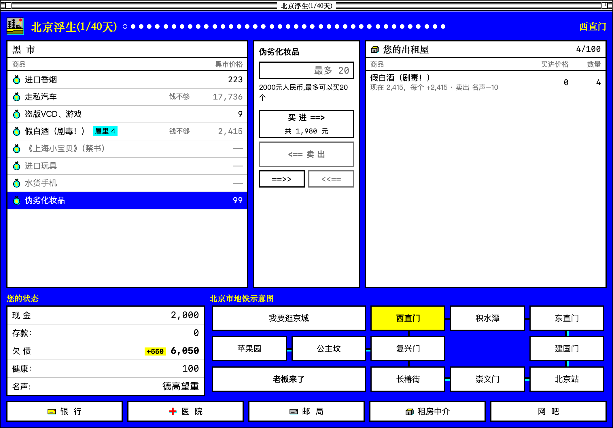
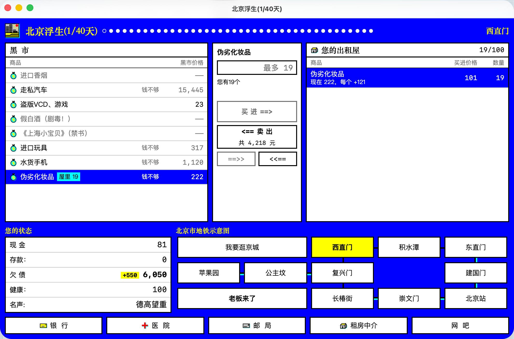

# Beijing Fusheng (北京浮生记)

An AI System 6 app: the 2001 Windows shareware game 《北京浮生记》
(Beijing.exe V1.2.2 build 0103) with its rules and its text as they were,
running in a desk window.

**The game is Guo Xianghao's (郭祥昊, Guoly Computing, 2001).** Every word
you read in it, every price, every event and every joke is his. This
package is a port made with his permission: the rules were rewritten from
his program, the text was carried over without changing a character, and
the pictures were redrawn after his. What is new here is only the
engineering and the layout.

<p> </p>

You arrive in Beijing with 2000 yuan and a debt to the village head that
grows ten percent a day. You have forty days to trade eight kinds of grey
goods between ten subway stations.

- `kernel/`: the rules, in Rust, compiled to a 12 KB WebAssembly module
  with no imports. The same seed and the same commands give the same bytes.
- `data/`: the price ranges, the three event tables and every line of text,
  exported from the original program. Each entry names its address.
- `src/`: the interface (TypeScript and Preact). It holds no rules.
- `art/`: seven icons and four pictures, redrawn as vector masters.
- `docs/`: the design documents (Chinese): audit, directions, art bible,
  specification, kernel contract, key screens.

The game's own words are Simplified Chinese and are not translated. The
desk's menus and the few labels this app adds exist in English and Chinese.

## Commands

```bash
npm install
npm run dev          # the app on its own page (add ?seed=1&lang=zh to repeat a game)
npm run check        # types, lint, tests, build and ais6-app check
npm run kernel       # rules.json -> tables.rs -> wasm -> src/kernel/kernel.wasm.ts (needs Rust)
npm run kernel:test  # the kernel's own tests (cargo)
npm run art          # rewrite art/ (PNG exports need rsvg-convert)
```

## In a desk

It declares `state`, `files`, `appearance` and `snapshot`, and no services.
The game is saved through `state.*` after every move; 存 盘 on the boss
screen exports a text file through `files.export`.

With a local desk running: `npx ais6-app install . --desk <url>`, then
approve it in Applications → Get More.

## Licence and credit

The code and the drawings are MIT. The game's text, rules and numbers are
Guo Xianghao's and are used with his permission; the MIT licence does not
cover them. See [LICENSES.md](LICENSES.md).
