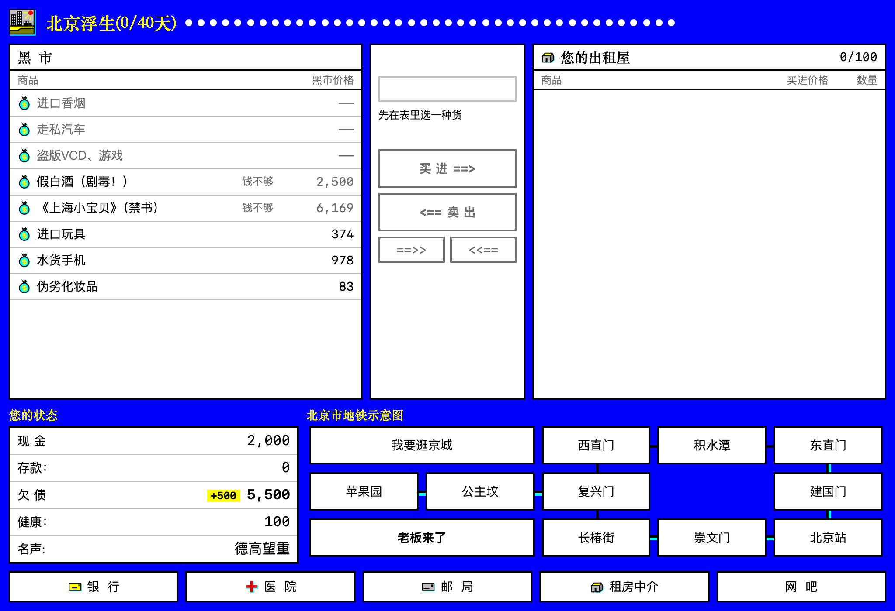
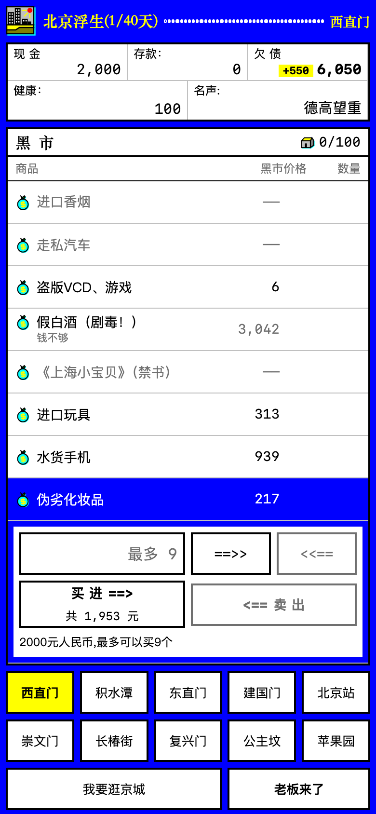

<!-- canonical-source: packages/beijing-fusheng/README.md -->
<!-- source-sha256: 39ab1c8c24478b575f459a60274be417e212a9187dee800695e1e8eec1ca6f7e -->

> 英文版为准 ・ 仅供人类参考

# 北京浮生记

AI System 6 的一个应用：2001 年的 Windows 共享软件《北京浮生记》（Beijing.exe V1.2.2 build 0103），规则和文案照原样，跑在桌面的一个窗口里。

**这个游戏是郭祥昊的（Guoly Computing，2001）。** 您在里面读到的每一个字、每一个价格、每一件事、每一句玩笑，都是他写的。本包是经他同意做的移植：规则照他的程序重写，文字一个字没改地搬过来，图是照他的图重画的。这里新做的只有工程和版面。

<p> </p>

<p> </p>
<p> </p>

您从家乡来到北京，身上 2000 元，欠村长的债每天涨一成。四十天里，在二环十个地铁站之间倒卖八种灰色商品。

- `kernel/`：规则。Rust 编译成 12 KB 的 WebAssembly，没有任何导入。同一颗种子、同一串命令，得到逐字节相同的快照。
- `data/`：价格区间、三张事件表和全部原文，从原程序导出，每一条都写明地址。
- `src/`：界面（TypeScript 与 Preact），不含规则。
- `art/`：7 枚图标、4 张位图，矢量母版。
- `docs/`：设计文档：审计、三个方向、美术 bible、规格、内核契约、关键画面、远期备忘、自检表。

游戏原文是简体中文，不翻译、不改字。桌面的菜单和本应用加的少量标注有中英两种。

## 命令

```bash
npm install
npm run dev          # 在自己的页面上跑（加 ?seed=1&lang=zh 可重现一局）
npm run check        # 类型、lint、测试、构建、ais6-app check
npm run kernel       # rules.json → tables.rs → wasm → src/kernel/kernel.wasm.ts（需要 Rust）
npm run kernel:test  # 内核自己的测试（cargo）
npm run art          # 重写 art/（导出 PNG 需要 rsvg-convert）
```

## 在桌面里

声明的能力：`state`、`files`、`appearance`、`snapshot`；不用任何服务。每走一步都经 `state.*` 存档；老板画面的「存 盘」经 `files.export` 存出一份文本。

本机桌面开着时：`npx ais6-app install . --desk <网址>`，再到「应用程序 → 取得更多」里批准。

## 许可与署名

代码和重画的图是 MIT。游戏的文字、规则与数值属于郭祥昊，经他同意使用，不在 MIT 许可之内。见 [LICENSES.zh-CN.md](LICENSES.zh-CN.md)。
